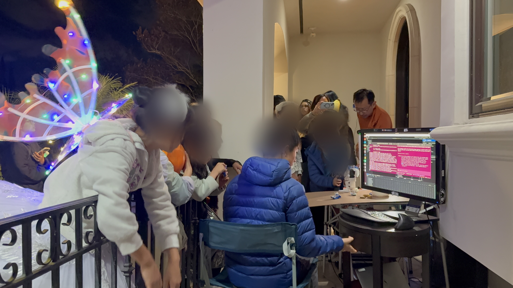
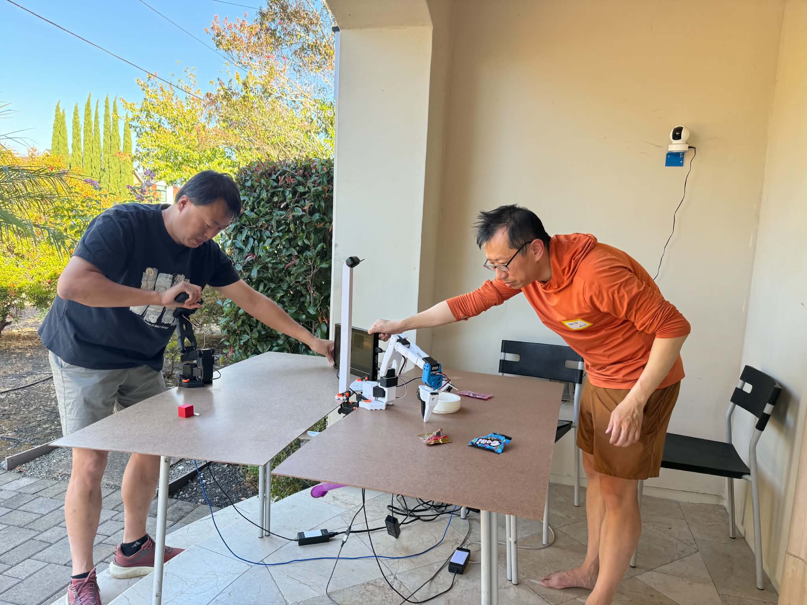
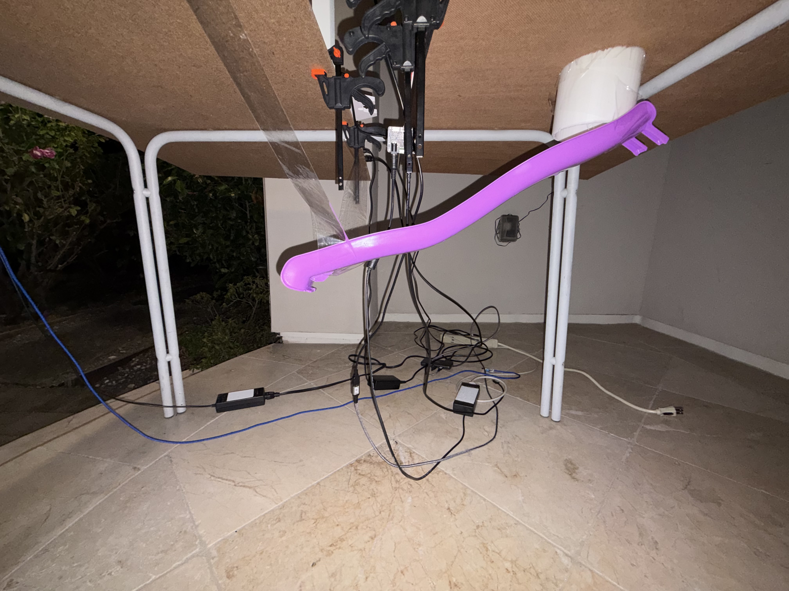
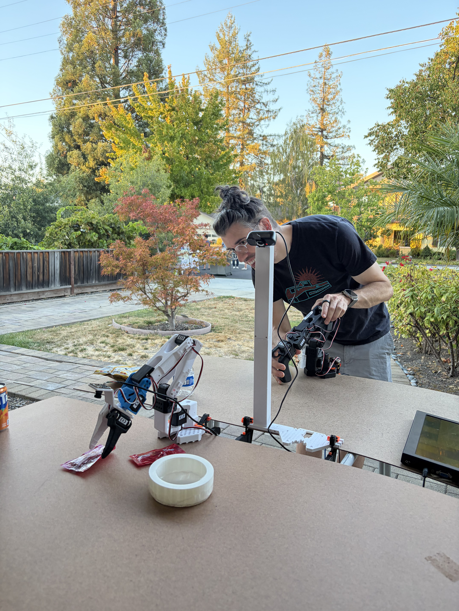
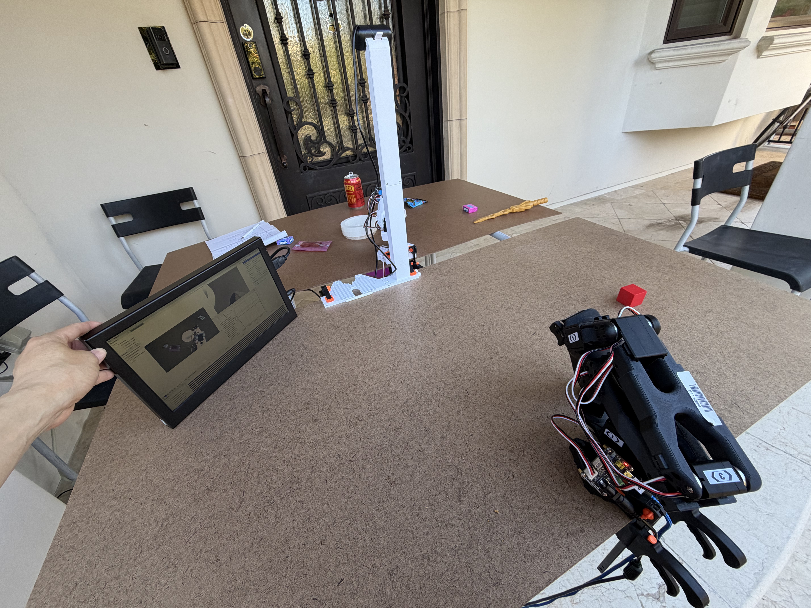
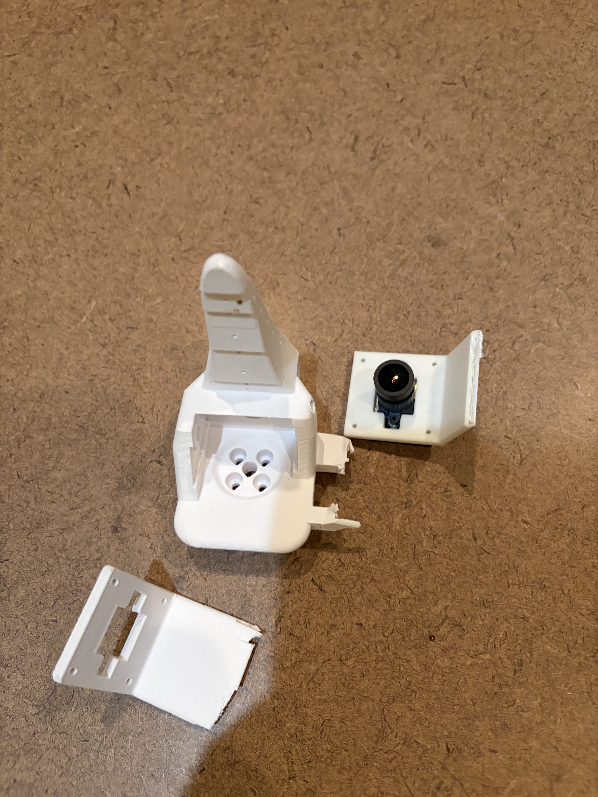

*What happens when children become robot operators—and help us learn how to build better robots?*

*Halloween robot operation station*

This Halloween, we [built a pair of SO-101 robotic arms](#references) at our house with a simple challenge for the trick-and-treat invaders: **Want candy? Use a robot arm to pick it up!**

The setup was straightforward. One arm was the **leader**, which children could move directly with their hands. The other was the **follower**, which mirrored the leader’s movements. The goal was to pick up a piece of candy with the follower’s gripper and drop it into a hole.

We got a long line in front of the house. The kids loved it. They were excited to see the robot follow their motions, and even more excited when they successfully picked up a candy. They also discovered that **not all candies are equally easy for robots to pick up**. Small solid candy bars were relatively straightforward. Soft, flexible candy packets were much harder: they slipped, deformed, and often escaped the gripper. Still, some children surprised us with their patience and persistence, carefully adjusting the arm until they managed to pick up even the more difficult packets.

The robot arms probably hate it – because the children’s hands also gave the arms quite a workout. The wrist camera broke twice during the event. Fortunately, my son Vincent was able to fix it in a few minutes. Eventually, though, both the wrist-camera module and our spare part broke. Rather than shutting down the fun, Codex came to the rescue by quickly modifying our harness script to run with a single top-view camera without the wrist camera.

Watching the children experiment with robot control—sometimes struggling, sometimes improvising, and often celebrating enthusiastically when they succeeded—was a reminder of how engaging hands-on robotics can be.

And while the children were learning how to operate robots, **we were learning how to design robots that are more intuitive, robust, and friendly to humans**.

As a byproduct, we also collected recordings for future experiments—though I expect some very harsh quality reviews. :)

## Details: Three Iterations of a Children’s Robotic Teleoperation Station

The Halloween event was actually our **third iteration** of this experiment. Over the preceding weeks, we had been exploring how to turn a research-oriented teleoperation setup into something that children could use safely, repeatedly, and with minimal instruction.

### V0: a quick hack at a neighborhood block party

Our first version was an improvised setup for a neighborhood block party.

*V0 at block-party: two SO-101 arms on separate boards, with a simple candy-picking workflow.*

We placed two SO-101 robotic arms on a single table, each mounted on its own board—one for the leader and one for the follower. The operator operates the leader; the follower would mimic the leader joint-by-joint. The follower’s board had a hole, and underneath it we installed a slide so that once the robot dropped a candy in, it would slide back to the leader’s side for the operator to pick it up.

*The under-table candy-return slide – once the follower robot arm picks up and drops the candy, it slides down to the operator.*

We paid special attention to the operator – which could be children. No camera facing them; all the energized moving pieces (the follower) are out of their reach. One idea we briefly considered was a partially-powered leader arm, so children could feel the friction or mechanical constraints of the follower through some resistance in the leader arm. We did not pursue it in this project because that would have an energized component in the leader arm to interact with children directly.

*V0 in action during early experimentation.*

*An early view of the teleoperation workspace and camera-preview interface.*

We used a MacBook Air to run LeRobot and record the demonstrations. About 10 children tried the system over two hours, and the setup also attracted curious parents.

This first prototype taught us several things immediately:

- **Children are tough on hardware.** The leader arm was easy to stress because children naturally pushed and pulled it much harder than experienced operators would.

- **The stock LeRobot UX was not ideal for people that operated the robot the first time without training.** We needed voice warnings when the leader moved too quickly for the follower to keep up, plus a simpler operator flow with separate controls for a facilitator to start, finish, skip, or cancel an episode. We also needed a way to restart the recording process cleanly between runs if resource use accumulated.

- **The surrounding physical environment mattered.** Some children crawled under the table to reach candy through the ladder.

- **Storage mattered too.** We actually ran out of space on the MacBook Air.

We also thought that showing children the robot’s camera views on a screen would help. This turned out to matter less during Halloween, as the children were so fascinated by the candy itself.

### V1: a third-grade science class

For the next iteration, we reinforced both the leader and follower arms, added a wrapper around the lerobot-record with voice prompts, and set up a board to keep children from crawling under the table.

We then brought the setup to my daughter’s third-grade classroom as a guest science lesson. About 15 children tried it in an hour.

The classroom session went much more smoothly. The voice prompts worked well, and the reinforced hardware held up without any damage.

Still, we found additional issues:

- the leader’s clamps could interfere with the child operator,

- the MacBook was still slow between episode recordings,

- the gripper has no touch sensors, and children sometimes crushed the candy while picking it up. Tactile sensing is a bigger project, so we decided to use firmer candies and leave tactile sensing for another year.

One thing we didn’t appreciate enough at this experiment was the teacher’s effective queue management that keeps the kids in line waiting patiently. That is very different when we operate in the real Halloween setup.

### V2 for real: Halloween — putting everything to the stress test

For Halloween, we mounted the leader more securely on a wooden board – removing all children facing clamps, we further stabilized the table, and changed the controller from the MacBook to a more powerful Linux desktop.

We packaged our modified LeRobot source, calibration files, and configuration tools, reproduced the environment on Ubuntu, and verified that teleoperation, recording, and replay all worked before the event.

We also switched from 30 FPS to **10 FPS** recording, hoping to reduce recording and processing overhead for a relatively slow candy-picking task. We added spoken prompts such as “You can start pick up” and a reminder to return the arms slowly to their original position after a recording ends.

Halloween night produced four particularly important lessons.

#### Lesson 1: the wrist camera is now the weakest part

*The wrist-camera module and mount after repeated failures.*

The most persistent failure point was the follower’s wrist-mounted camera. Part of the issue was a mechanical asymmetry: the follower had a wrist-camera module, while the leader did not. That meant a child could rotate the leader’s wrist into a position that felt perfectly reasonable, even though the corresponding follower’s wrist movement would collide the wrist camera into the follower robot’s own arm.

In the future, we plan to give the leader wrist a matching physical representation of the wrist-camera module so operators naturally feel the same movement constraints before commanding the follower into a collision.

#### Lesson 2: resetting to the starting position was harder than expected

Once children successfully dropped a candy into the target, many of them were so excited that they simply let go of the leader's arm. From their perspective, the task was complete. From the system’s perspective, however, both leader and follower arms were now stuck in a random position and needed to be reset for the next operator.

We added voice reminders asking them to return the robot slowly to its original position, but it became clear that **reset and recovery are part of the task design**, not just an afterthought.

#### Lesson 3: Linux is different from Mac

We also learned that Linux and USB devices can introduce their own friction: after disconnects or moving between locations, camera device indices could change, requiring us to rediscover and remap devices. The MacBook seemed to have more consistent device mapping.

#### Lesson 4: Wiring is still messy

Even after three iterations, the wiring remained messy. Between cameras, USB connections, power supplies, and the control computer, the physical setup was still fragile and cumbersome. For a future iteration, we may explore Hao’s wireless-arm design to improve portability and reduce failure points.

### What did we collect, and what’s next?

We collected more than 100 trajectories across two-camera and single-camera setups, after wrist-camera failures forced us to change the configuration.

Our hypothesis is that these demonstrations are less consistent than those of experienced operators. We want to test whether they can still support a useful candy-picking policy, and whether filtering or processing the recordings improves performance.

### Final thoughts: children are the most honest robot testers

After three iterations, one thing has become very clear to me: **children are the most brutal—but also the most honest—testers of robotic systems**. They simply try to accomplish the task. In doing so, they find weak points quickly—and they also reveal what makes the experience delightful.

**We set out to teach children how to operate robots. In the process, they taught us how to build better ones.**

## References

- Experiment Log: [October 25 — SO-101 Teleoperation Preparation](https://github.com/davidwei/robotics-labbook/tree/main/sessions/2026-10-25-so101-teleop-preparation)

- Experiment Log: [October 31 — SO-101 Linux Migration and Halloween Experiment](https://github.com/davidwei/robotics-labbook/tree/main/sessions/2026-10-31-so101-linux-migration)

- Code: [Moissan Club’s LeRobot Fork](https://github.com/MoissanClub/lerobot/tree/lab/so101-intel-warning-20261023)

- [SO-101 building steps](https://www.youtube.com/playlist?list=PLqoOXvF1Hm4L7YJGwGeV_VAEVuKCXnY_B)
