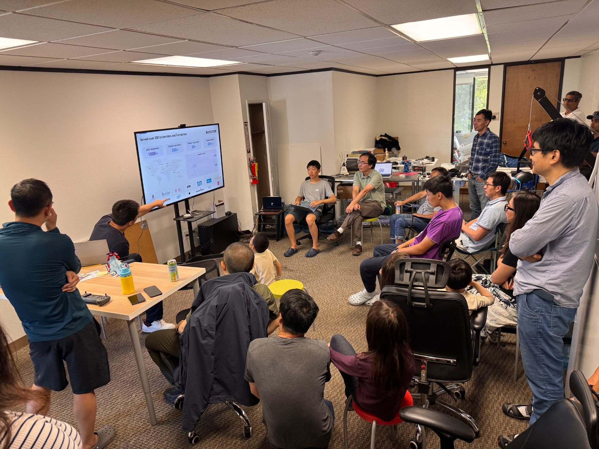

Hi friends,

August was a busy month at Moissan Club. We set up this group, started Friday open hours, and opened up on-demand visits through our signup page. We also had Ben from Booster stop by to [demo the K1 and the latest T2 playing soccer](https://www.youtube.com/shorts/vv7iWl5hzsQ), followed by a great talk on what they’re building. And in a small but important step toward robotic civic leadership, one of our Unitree G1s [handled the ribbon cutting](https://www.youtube.com/shorts/tZmwWPzWj5A) at a store grand opening—successfully replacing the Burlingame mayor for approximately five seconds.

Back at the club, our “perfect handshake” project [made great progress](https://youtube.com/shorts/UKuVE7b0esA?si=NCYFvaYhuFOCVPsC), although teaching a robot something most humans still get slightly wrong turns out to be [harder than expected](https://www.youtube.com/shorts/b72AAbJoHrY). We also performed some surgery on a BrainCo dexterous hand: [teardown, broken thumb motor replacement, reassembly](https://www.youtube.com/watch?v=qOPOSDcAWAM&list=PLJ-QE0qH_zlPc2aZF06jHUqJB9YO9Vo6f), and—most importantly—a functioning thumb again.

And somehow, our GitHub has been even busier. Recent work includes more [user-friendly teleop features](https://github.com/MoissanClub/xr_teleoperate/tree/frank/quest-controller-state-bindings), [hardware-accelerated video encoding](https://github.com/MoissanClub/realsense-webrtc) to reduce CPU load and latency, and safer flashing that preserves the data partition, among many other improvements: https://github.com/MoissanClub/

We’ve also uploaded demos to our YouTube playlist, with more on the way: https://www.youtube.com/playlist?list=PLB0wyUrVTrj4

If you have friends who are interested in joining our Google group, please ask them to fill https://forms.gle/KULHJVbEMEHrauEG7

See you soon,

Moissan Club