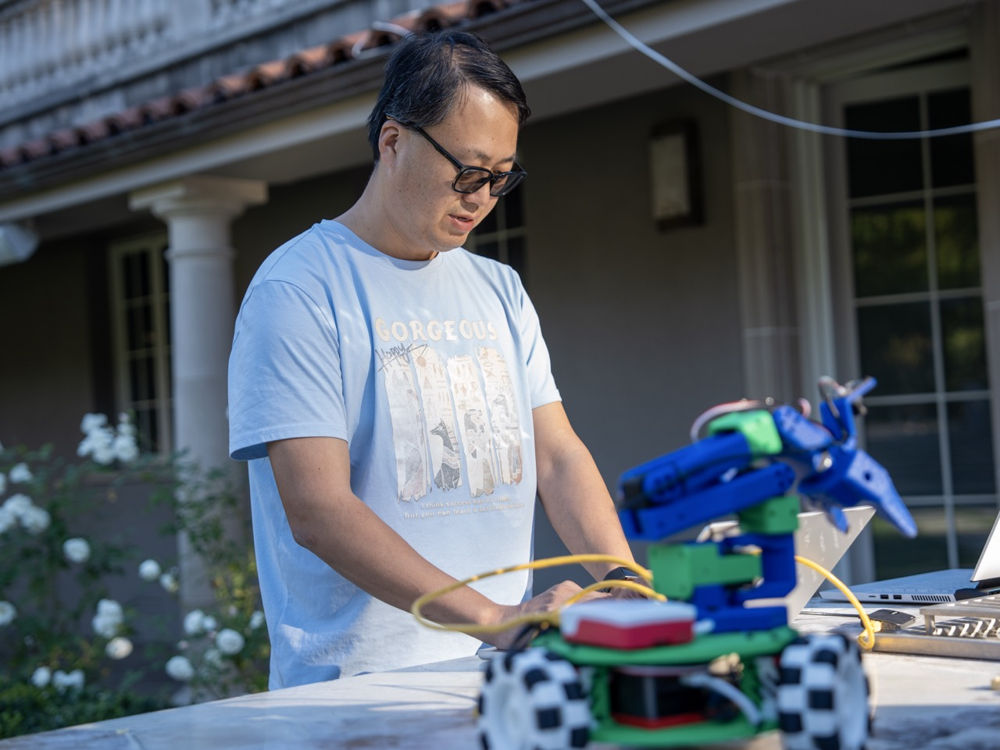
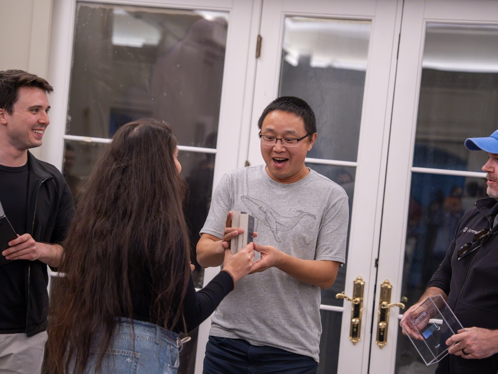
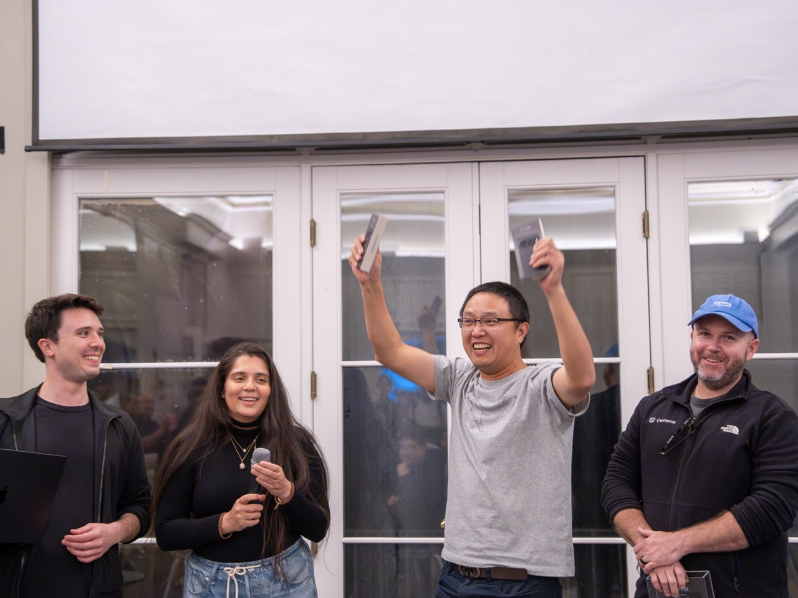
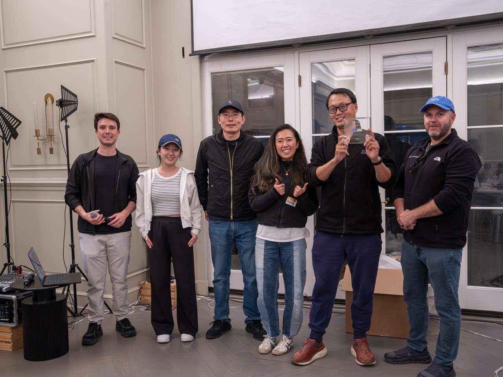
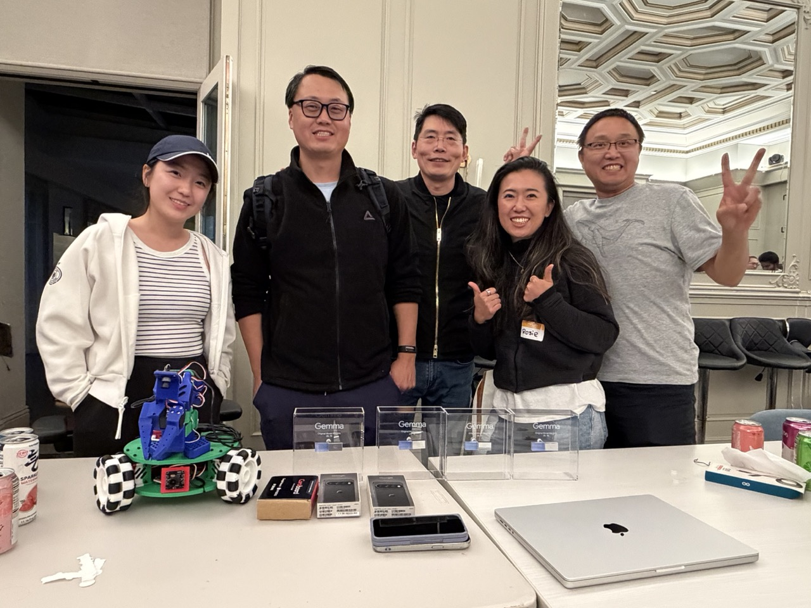

Hi everyone,

Big news: we brought home four awards from the [Google Gemma Hardware Hackathon at AGI House](https://www.agihouse.org/events/the-google-gemma-hardware-hackathon)!

🏆🏆🏆 Frank’s WonderAgent scooped up three awards!
🏆 Our cross-embodiment Gemma harness earned one more!

Huge congratulations to Frank and harness team(Rosie, Hao, Junda and Alice). It’s exciting to see MoissanClub’s ideas come to life—and get recognized along the way.

Join us in celebrating the teams and their hard work. Here’s to more experiments, more collaboration, and more things that make us say, “Wait, that actually works!” 🚀🚀🚀

Cheers,
MoissanClub